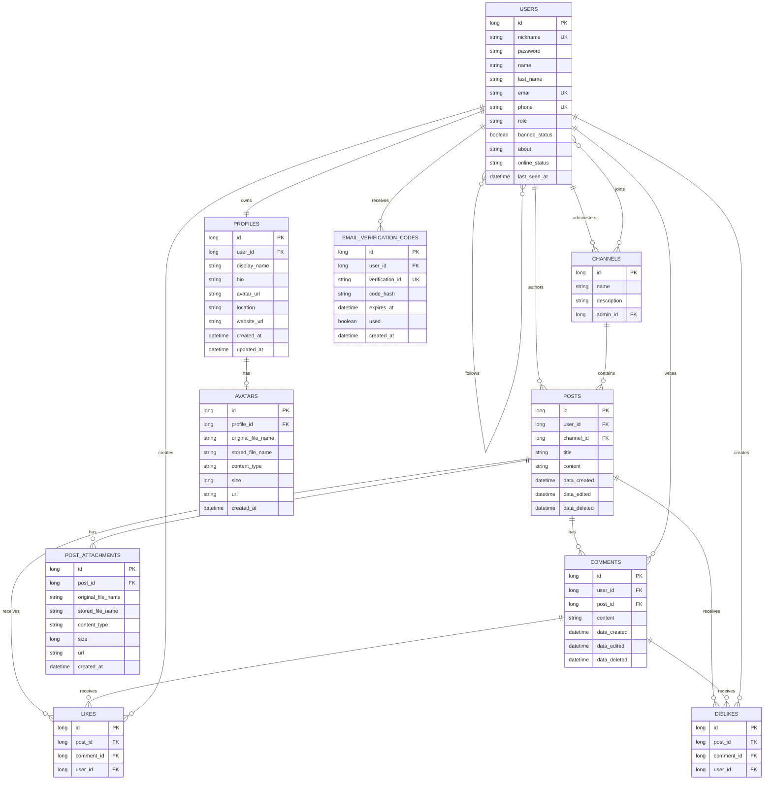

# Entity Schema

This document describes the current JPA entities and their database shape.

## ER Diagram



## Tables

### users

Java class: `org.example.entity.User`

| Field | Column | Notes |
| --- | --- | --- |
| `id` | `id` | Primary key |
| `nickname` | `nickname` | Required and unique in JPA |
| `password` | `password` | Required in JPA |
| `name` | `name` | Nullable |
| `lastName` | `last_name` | Nullable |
| `email` | `email` | Unique in JPA |
| `phone` | `phone` | Unique in JPA |
| `role` | `role` | Enum string: `ADMIN`, `USER` |
| `bannedStatus` | `banned_status` | Boolean |
| `about` | `about` | Nullable |
| `onlineStatus` | `online_status` | Enum string: `ONLINE`, `OFFLINE` |
| `lastSeenAt` | `last_seen_at` | Nullable |

Relationships:

| Field | Mapping |
| --- | --- |
| `posts` | `@OneToMany(mappedBy = "user")` |
| `administrativeChannels` | `@OneToMany(mappedBy = "admin")` |
| `channels` | `@ManyToMany` through `channel_members(user_id, channel_id)` |
| `following` | `@ManyToMany` through `user_following(user_id, following_id)` |
| `followers` | `@ManyToMany` through `user_followers(user_id, follower_id)` |

### profiles

Java class: `org.example.entity.Profile`

| Field | Column | Notes |
| --- | --- | --- |
| `id` | `id` | Primary key |
| `user` | `user_id` | Required, unique FK to `users.id` |
| `displayName` | `display_name` | Max 80 |
| `bio` | `bio` | Max 500 |
| `avatarUrl` | `avatar_url` | Public avatar download URL |
| `location` | `location` | Nullable |
| `websiteUrl` | `website_url` | Nullable |
| `createdAt` | `created_at` | Nullable |
| `updatedAt` | `updated_at` | Nullable |

Relationships:

| Field | Mapping |
| --- | --- |
| `user` | `@OneToOne(fetch = LAZY)` |
| `avatar` | `@OneToOne(mappedBy = "profile", cascade = ALL, orphanRemoval = true)` |

### avatars

Java class: `org.example.entity.Avatar`

| Field | Column | Notes |
| --- | --- | --- |
| `id` | `id` | Primary key |
| `profile` | `profile_id` | Required, unique FK to `profiles.id` |
| `originalFileName` | `original_file_name` | Original uploaded file name |
| `storedFileName` | `stored_file_name` | File name on disk |
| `contentType` | `content_type` | MIME type |
| `size` | `size` | File size in bytes |
| `url` | `url` | Download endpoint |
| `createdAt` | `created_at` | Upload time |

### channels

Java class: `org.example.entity.Channel`

| Field | Column | Notes |
| --- | --- | --- |
| `id` | `id` | Primary key |
| `name` | `name` | Nullable |
| `description` | `description` | Nullable |
| `admin` | `admin_id` | FK to `users.id` |

Relationships:

| Field | Mapping |
| --- | --- |
| `admin` | `@ManyToOne` |
| `members` | `@ManyToMany(mappedBy = "channels")` |
| `posts` | `@OneToMany(mappedBy = "channel")` |

### posts

Java class: `org.example.entity.Post`

| Field | Column | Notes |
| --- | --- | --- |
| `id` | `id` | Primary key |
| `user` | `user_id` | FK to `users.id` |
| `channel` | `channel_id` | FK to `channels.id` |
| `title` | `title` | Nullable in DB |
| `content` | `content` | Nullable in DB |
| `dataCreated` | `data_created` | Creation time |
| `dataEdited` | `data_edited` | Edit time |
| `dataDeleted` | `data_deleted` | Soft delete marker |

Relationships:

| Field | Mapping |
| --- | --- |
| `user` | `@ManyToOne` |
| `channel` | `@ManyToOne` |
| `likes` | `@OneToMany(mappedBy = "post")` |
| `dislikes` | `@OneToMany(mappedBy = "post")` |
| `comments` | `@OneToMany(mappedBy = "post")` |
| `attachments` | `@OneToMany(mappedBy = "post")` |

### post_attachments

Java class: `org.example.entity.PostAttachment`

| Field | Column | Notes |
| --- | --- | --- |
| `id` | `id` | Primary key |
| `post` | `post_id` | Required FK to `posts.id` |
| `originalFileName` | `original_file_name` | Original uploaded file name |
| `storedFileName` | `stored_file_name` | File name on disk |
| `contentType` | `content_type` | MIME type |
| `size` | `size` | File size in bytes |
| `url` | `url` | Download endpoint |
| `createdAt` | `created_at` | Upload time |

### comments

Java class: `org.example.entity.Comment`

| Field | Column | Notes |
| --- | --- | --- |
| `id` | `id` | Primary key |
| `user` | `user_id` | FK to `users.id` |
| `post` | `post_id` | FK to `posts.id` |
| `content` | `content` | Nullable in DB |
| `dataCreated` | `data_created` | Creation time |
| `dataEdited` | `data_edited` | Edit time |
| `dataDeleted` | `data_deleted` | Soft delete marker |

Relationships:

| Field | Mapping |
| --- | --- |
| `user` | `@ManyToOne` |
| `post` | `@ManyToOne` |
| `likes` | `@OneToMany` |
| `dislikes` | `@OneToMany` |

### likes

Java class: `org.example.entity.Like`

| Field | Column | Notes |
| --- | --- | --- |
| `id` | `id` | Primary key |
| `post` | `post_id` | Nullable FK to `posts.id` |
| `comment` | `comment_id` | Nullable FK to `comments.id` |
| `user` | `user_id` | FK to `users.id` |

One like belongs either to a post or to a comment.

### dislikes

Java class: `org.example.entity.Dislike`

| Field | Column | Notes |
| --- | --- | --- |
| `id` | `id` | Primary key |
| `post` | `post_id` | Nullable FK to `posts.id` |
| `comment` | `comment_id` | Nullable FK to `comments.id` |
| `user` | `user_id` | FK to `users.id` |

One dislike belongs either to a post or to a comment.

### email_verification_codes

Java class: `org.example.entity.EmailVerificationCode`

| Field | Column | Notes |
| --- | --- | --- |
| `id` | `id` | Primary key |
| `user` | `user_id` | Required FK to `users.id` |
| `verificationId` | `verification_id` | Unique temporary id sent to frontend |
| `codeHash` | `code_hash` | BCrypt hash of the six-digit email code |
| `expiresAt` | `expires_at` | Expiration timestamp |
| `used` | `used` | True after successful verify or expiration |
| `createdAt` | `created_at` | Creation timestamp |

## Join Tables

| Table | Purpose | Columns |
| --- | --- | --- |
| `channel_members` | Users joined to channels | `user_id`, `channel_id` |
| `user_following` | Users followed by a user | `user_id`, `following_id` |
| `user_followers` | Users following a user | `user_id`, `follower_id` |
| `comments_likes` | Legacy/unowned comment likes collection from `Comment.likes` | `comment_id`, `likes_id` |
| `comments_dislikes` | Legacy/unowned comment dislikes collection from `Comment.dislikes` | `comment_id`, `dislikes_id` |

## Enums

### UserRoles

```text
ADMIN
USER
```

Stored in `users.role`.

### UserStatus

```text
ONLINE
OFFLINE
```

Stored in `users.online_status`.

## Notes

- `posts.data_deleted` and `comments.data_deleted` are used for soft delete.
- Uploaded post files are stored on disk under `app.uploads.posts-dir`.
- Uploaded avatar files are stored on disk under `app.uploads.avatars-dir`.
- Existing Flyway migrations are append-only. Add new schema changes as a new `V...__description.sql` file.
